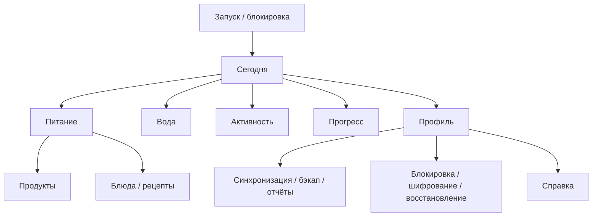

# FitEasy — карта экранов

0.3.0/7: прогресс выбирает день/неделю/месяц/год/несколько лет/всё время/диапазон, точку отсчёта и направление. Календарь маркирует наличие дневника и типы, показывает счётчики выбранного дня, умеет переход YYYY-MM. Заметки фильтруют тип/папку, общий просмотр без папок; папки создаются/переименовываются/удаляются без удаления заметок, заметки перемещаются. Вид карточки/компактный список/сетка и четыре переключателя штампов доступны в заметках; штампы также в Оформлении. PROGRESS_PERIODS.md, NOTES.md.

Обновление 0.2.4/6: профиль открывает меню из восьми разделов с поиском (личное, оформление, язык/единицы, напоминания, защита, LAN, данные, справка). В данных — демо 7/30 дней, обычное/принудительное удаление, категории и двойное подтверждение полной очистки. Прогресс — цвета и виды графиков, общий вид, выбор дня касанием, записи замеров. DATA_RESET_AND_CHARTS.md описывает ограничения и сохранение зависимостей.

Версия 0.1, 2026-10-02. Карта соответствует [PRODUCT.md](PRODUCT.md). ID экранов — для связей с задачами и макетами; окончательные названия переводятся на десять языков.

## Общая структура

Шесть разделов: Сегодня, Питание, Вода, Активность, Прогресс, Профиль. На телефоне предложены пять нижних вкладок и кнопка Профиля сверху. На планшете и Windows — общий по структуре широкий интерфейс, с возможностью показывать список и детали рядом. Конкретное размещение навигации остаётся задачей макета. Состояние выбора даты и возврат из редакторов должны быть предсказуемы.

## Запуск и Сегодня

| ID | Экран | Действия и состояния | Требования |
|---|---|---|---|
| SC-001 | Первое знакомство | Язык, краткое объяснение учёта, необязательное заполнение профиля | FE-005/006 |
| SC-002 | Блокировка | Выбранный способ входа, биометрия, задержка/лимит, переход к восстановлению | FE-021 |
| SC-003 | Восстановление | Вопрос, SMTP-код или TOTP; после проверки новый секрет | FE-021 |
| SC-010 | Сегодня | Пять типов карточек, дата, быстрые действия, переходы к деталям | FE-007 |
| SC-011 | Настройка карточек | Порядок, видимость, возврат карточек/исходного вида | FE-007 |
| SC-012 | Календарь / выбранный день | Сводка, прошлые записи, ввод пропущенного, переход в редактор | FE-008 |
| SC-013 | Копирование на дату | Дата/время и предварительное описание новой записи | FE-008 |

## Питание

| ID | Экран | Действия и состояния | Требования |
|---|---|---|---|
| SC-020 | Дневник питания | Группы приёмов пищи, итоги, добавить/изменить/удалить/копировать | FE-010 |
| SC-021 | Каталог продуктов | Поиск, категории, недавние/избранное, происхождение данных | FE-009/010 |
| SC-022 | Каталог блюд | Отдельный поиск, кухня/вариант, категории, избранное | FE-009/010 |
| SC-023 | Штрихкод | Камера/ручной код, найденный продукт, нет результата/нет разрешения | FE-010 |
| SC-024 | Продукт или блюдо | Состав, источник, база расчёта, вариант, меры | FE-009/010 |
| SC-025 | Количество / запись | Граммы/свои меры, пересчёт, приём пищи, дата/время, сохранение | FE-010 |
| SC-026 | Свой продукт / корректировка | Название, нутриенты, основа, меры, необязательный штрихкод | FE-009/010 |
| SC-027 | Свои блюда и рецепты | Открыть, редактировать, использовать в дневнике | FE-011 |
| SC-028 | Редактор рецепта | Ингредиенты, количества, шаги, готовый вес/порции, расчёты, сохранить блюдо | FE-011 |
| SC-029 | Приёмы пищи и меры | Добавить/переименовать/переставить/архивировать, сохранить историю | FE-010 |
| SC-02A | Каталоги и обновления | Версия, источники, покрытие, состояние пополнения; механизм ещё проектируется | FE-009 |

## Вода и активность

| ID | Экран | Действия и состояния | Требования |
|---|---|---|---|
| SC-030 | Вода и напитки | Чистая вода/все напитки, цель, быстрые объёмы, история | FE-012/013 |
| SC-031 | Добавить/изменить напиток | Тип/каталог, объём, состав/порция, дата; один учёт питания | FE-012 |
| SC-032 | Цель жидкости | Режим вода/все напитки, объём, пауза/отключение | FE-013 |
| SC-040 | Активность | Шаги, прогулки, комплексы, дата/история | FE-014/015 |
| SC-041 | Шаги и источники | Телефон/Health Connect, доступность, разрешения, цель/история | FE-014 |
| SC-042 | Прогулка / таймер | Начать/пауза/стоп, длительность и подтверждение записи | FE-014 |
| SC-043 | Ручная активность | Тип, длительность, необязательная дистанция, дата/редактирование | FE-014 |
| SC-044 | Комплексы и упражнения | Готовые/свои, уровень, оборудование, инструкция | FE-015 |
| SC-045 | Редактор комплекса | Упражнения/порядок/время или повторы/отдых | FE-015 |
| SC-046 | Выполнение комплекса | Текущее упражнение, таймер, пауза/пропуск/стоп | FE-015 |
| SC-047 | Результат / история сессии | Подтвердить выполнение, версия комплекса, повтор/копирование | FE-008/015 |

## Прогресс и профиль

| ID | Экран | Действия и состояния | Требования |
|---|---|---|---|
| SC-050 | Прогресс | Неделя/месяц, графики выбранных показателей, скрытие | FE-016 |
| SC-051 | Вес и замеры | История, добавить/изменить вес/талию/бёдра/грудь, единицы | FE-016 |
| SC-052 | Калькуляторы | ИМТ/энергия, входные данные, формула и ограничения | FE-017 |
| SC-053 | Пересчёт цели | Старое/новое, причина, принять/отклонить, авто-применение | FE-017 |
| SC-060 | Профиль | Один человек, необязательные исходные данные | FE-006 |
| SC-061 | Цели | Вес/питание/вода/шаги/активность, изменить/пауза/отключить, история | FE-013/017 |
| SC-062 | Напоминания | Список, выключатель, ближайшее срабатывание | FE-018 |
| SC-063 | Расписание | Даты/дни/интервалы/время/границы, тихие часы, отложить, описание | FE-018 |
| SC-064 | Оформление | Тема, палитра/свой цвет, текст, фон, предварительный просмотр | FE-003 |
| SC-065 | Язык и единицы | Десять языков, доступные единицы, явные варианты fl oz | FE-005/019 |
| SC-066 | Корзина | Срок, восстановить, удалить навсегда; связи данных | FE-020 |

## Защита и перенос данных

| ID | Экран | Действия и состояния | Требования |
|---|---|---|---|
| SC-070 | Блокировка и попытки | Метод/биометрия/таймаут, задержки/лимит, подтверждение удаления | FE-021 |
| SC-071 | Способы восстановления | Вопрос, SMTP, TOTP; настроить/заменить/убрать | FE-021 |
| SC-072 | SMTP | Сервер/порт/TLS/логин/пароль/адреса, тестовое письмо по действию | FE-021 |
| SC-073 | TOTP | QR/ручной ключ, проверка кода, замена/удаление | FE-021 |
| SC-074 | Шифрование базы | Выключено по умолчанию, преобразование, успех/ошибка/восстановление | FE-021 |
| SC-080 | LAN-синхронизация | Ждать/искать, доверенные устройства, состояние/результаты | FE-021 |
| SC-081 | Сопряжение | Код, выбор и подтверждение устройства | FE-021 |
| SC-082 | Параметры передачи | Направление/режим, галочки/все данные, зависимости, подтверждение | FE-021 |
| SC-083 | Конфликты | Местный/входящий/оба, необязательная автоматическая политика | FE-021 |
| SC-084 | Резервная копия | Файл .fiteasy, пароль по желанию, оформление галочкой | FE-021 |
| SC-085 | Восстановление файла | Проверка, слияние/копии/замещение, оформление отдельно | FE-021 |
| SC-086 | PDF/CSV отчёт | Разделы, период, единицы, сохранение файла | FE-021 |
| SC-090 | Справка | Офлайн темы/поиск, язык, контекстная статья | FE-005 |
| SC-091 | О приложении и источники | Версия, vibic777, лицензии, источники данных | FE-004/009 |

## Общие правила взаимодействия

- Пустые данные, неизвестные нутриенты и недоступные датчики имеют понятные состояния.
- Отмена редактора с изменениями требует продуманного сохранения/подтверждения; политика ещё выбирается.
- Критические операции показывают объём изменений и результат; ошибки не скрывают локальные данные.
- Клавиатура, масштаб текста и длинные переводы не закрывают основные действия.
- Макеты телефона, планшета и Windows должны ссылаться на эти ID; объединение экранов в панели не меняет функций.
# Дополнение 2026-10-02

CAL-01: нажатием даты — календарь месяца/повестка/маркеры; переход в дневник выбранного дня. SCH-01: из календаря — папка расписаний и отдельные напоминания; редактор графика/строк и назначение уведомлений. NTS-01: кнопка «Заметки» в заголовке — поиск/текст/рисунок/список/корзина. Основные пять вкладок телефона сохраняются. Общие диалоги работают на Android/Windows; масштаб/ширина и жесты требуют практической проверки. Windows галочка трея в профиле/настройках.

D087 (0.4.13/33): «Профиль и настройки», «Защита и восстановление» и «Синхронизация» — полноэкранные страницы со стрелкой «Назад» в шапке; панели разделов на них скрыты. На остальных экранах одна панель разделов: строка на телефоне, боковая на широком окне.

D092 (0.4.16/36): «Питание» и «Вода» — главный экран раздела плюс полноэкранные пункты меню («Продукты и блюда», «Записи напитков»). Меню настроек — строки со значком, названием, содержанием и стрелкой. Вход по PIN — экранная панель.

D094 (0.4.18/38): справочник упражнений — полноэкранная страница: строка значков, скрываемый ряд фильтров, фигура на всё свободное место, ряд действий, режим «Показать упражнение».

D095–D096 (0.4.19/39): экран входа с PIN-панелью (автоотправка, клавиша ввода), настройки защиты в виде меню со страницами; строка об отключённых анимациях в справочнике ведёт в «Оформление».

D097–D101 (0.4.20/40): «Настройки → Напоминания» и «Расписания» показывают карточки напоминаний; «Расписания» — полноэкранная страница. Редактор напоминания: время часами, повтор четырьмя вариантами, мелодия, громкость, нарастание. Справочник упражнений и редактор каркаса при режиме экономии батареи показывают строку с причиной и переходом к переключателю. «Защита» получила страницу «Автоблокировка» и готовые вопросы. Страница синхронизации — по образцу Notio.

D104 (0.4.21/41): строки меню настроек и защиты без стрелок. «Профиль»: три строки — Личные данные, Цели, Приёмы пищи — с пояснениями. «Оформление»: «Выбор темы:» и три значка; стили; одна строка «Акцент / RGB», «Фоны разделов», «Анимации» с переключателем. «Напоминания»: «+ Напоминание», «Расписания», «Календарь» в одной строке.

D105–D106 (0.4.22/42): страницы «Синхронизация между устройствами», «Безопасность и приватность» и «Резервная копия» повторяют Notio: блоки с заголовком и пояснением, широкие кнопки с названиями. «Резервная копия»: Ваши данные, Пароль резервной копии, Шифрование базы данных, затем блоки FitEasy — Обмен справочниками, Отчёты и корзина, Демонстрация и обнуление.

D107 (0.4.23/43): меню настроек получило раздел «Корзина»; «Справка» стала «Справка и о приложении». Корзина и справка — полноэкранные страницы. «Резервная копия» → «Шифрование базы данных»: переключатель, пароль базы с показом, «Копировать», «Отправить пароль по почте», экспорт и импорт файла базы, «Сменить пароль базы».

D108 (0.4.24/44): всё, что редактируется, открывается страницей во весь экран — запись дневника, напиток, рецепт, профиль, цели, единицы, отчёт, период прогресса, оформление графиков и фонов, расписание, календарь, комплекс и его выполнение, заметка, папки заметок, журнал, база данных. Короткие вопросы («Удалить?») и выбор времени остаются небольшими окнами. В окне Windows страница — слой, закрывающий окно целиком, без полей и затемнённого края; предел ширины формы 720 dp снят.

D117 / 0.4.33/53: подсказка значка держится 5 секунд (удержание пальца или задержка мыши) и по нажатию открывает справку на описании этого значка; справка — вкладки категорий, подвкладки разделов с обзором-меню и списком значков (рисунок, название, значение) на десяти языках. Описание — docs/HELP.md. Общий код Android/Windows; данные и форматы не менялись. Правило подтверждения синхронизации D116 проверено тестом на все восемь комбинаций.

D118 / 0.4.34/54: контекстный поиск в справке — результат показывает найденное внутри фразы с выделением, первыми идут результаты из категории текущего места, в открытом разделе искомое остаётся выделенным. Общий код Android/Windows, десять языков. Журнал для Linux (docs/linux/LINUX_PLAN.md) восполнен за D102–D118 и ведётся в каждой поставке.

